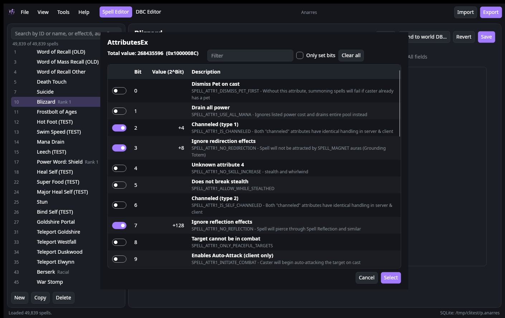

# Anarres


A spell editor and DBC editor for AzerothCore (World of Warcraft 3.3.5a, build 12340). It's written in C# on .NET 10
with an Avalonia interface, so it runs on Windows and Linux, and it shares its look with
[Urras](https://github.com/TheSCREWEDSoftware), its twin.

**Status:** early development, first version.


## Two editors in one app

- **Spell Editor**, laid out after Stoneharry's WoW Spell Editor: a searchable spell list (by ID, name, or
  `effect:6`, `aura:3`, `family:3`, `trigger:`, `icon:`...) and the chosen spell in tabs: Base, Attributes, Effects,
  Targets & Requirements, Procs & Interrupts, Items & Reagents, Localisation and All fields.
  - Effects, auras, targets, mechanics, powers and the rest are picked from named lists. Attribute, school,
    proc, interrupt, target-flag and shapeshift masks show the names of their set bits; `...` opens the bit list,
    with each bit's value and AzerothCore's name and notes.
  - Every field has a readable label; its tooltip gives the `spell_dbc` column name.
  - Cast times, durations, ranges, radii, icons and other spells are shown by what they mean, not just their index.
  - A live tooltip preview fills in `$s1`, `$d`, `$o1`, `$t1`, `${...}` sums, `$<variables>`, `$lsingular:plural;`
    and references to other spells.
  - New, Copy and Delete spells; Save, Revert; write a spell as SQL for `spell_dbc`, or send it straight to the
    world database.
- **DBC Editor**, in the spirit of WDBX Editor: every table in the project, or any `.dbc` opened straight from disk,
  in a fast grid that draws only what's on screen (Spell.dbc's 50,000 rows by 234 columns scroll smoothly).
  - Edit cells in place, add, copy and delete rows, filter by ID, text or `Column=value`.
  - Save to the project or back to the file, save as `.dbc`, CSV or SQL.
  - See and rename the columns of a layout, saved as a definition file that replaces the built-in one.




## The workflow

1. **Import** clean `.dbc` files into the project: from a folder (such as AzerothCore's client data `dbc` folder)
   or straight out of the client's MPQs, the newest copy of each file as the client sees it.
2. **Edit** with either editor.
3. **Export and deploy**: write the `.dbc` files, copy them to the worldserver's `dbc` folder, and pack them into a
   client patch MPQ (`patch-A.MPQ` by default) under `DBFilesClient`. Restart the worldserver and the client.

Unchanged tables export byte for byte the same as the files they came from.

### Where the data lives

- **SQLite project file** (`.anarres`): one local file, nothing to run.
- **MySQL or MariaDB**: work on a database directly, so it can also be queried and bulk-edited with any SQL tool,
  and shared by several people. The defaults match AzerothCore's (`localhost:3306`, `acore`/`acore`), and the
  database, `acore_dbc_extracted`, is created on first use.
  - *DBC names* (`Spell`, `SpellIcon`...) for a database just for DBC data, like Stoneharry's editor.
  - *AzerothCore names* (`spell_dbc`, ...) to work in `acore_world`'s own override tables, which the worldserver
    loads on top of the `.dbc` files.

### Without a window

`anarres-cli` does the same work from scripts and build servers, like Stoneharry's HeadlessExporter in his
[DBC editing workflow](https://github.com/stoneharry/DBC-Editing-Workflow):

```
anarres-cli import "C:\client-data\dbc" --only Spell,SpellIcon
anarres-cli export --server --patch
anarres-cli sql Spell --ids 90000,90001 --out custom_spells.sql
anarres-cli patch patch-A.MPQ Spell.dbc SpellIcon.dbc
```

See [docs/workflow.md](docs/workflow.md) for the full guide.

## Building

```
dotnet build src/Anarres.App
dotnet run --project src/Anarres.App
```

Or `start.bat` on Windows. Tests: `test.bat` / `./test.sh`, or `dotnet run --project tests/Anarres.Core.Tests`.

## Layouts and names

- The layouts of the 110 files AzerothCore loads, and their column names, come from AzerothCore's `*_dbc` world
  tables (`tools/generate-definitions.py`). Spell effect, aura, target, attribute and flag names come from
  AzerothCore's headers.
- The other 130 client files have layouts taken from the 3.3.5a client's record layouts
  (`tools/generate-client-definitions.py`), checked against real files.
- Anything else gets a layout guessed from its data, which you can rename and save.

## Credits

- [AzerothCore](https://www.azerothcore.org) for the DBC layouts and spell names (GPL-2.0-or-later).
- Stoneharry's [WoW Spell Editor](https://github.com/stoneharry/WoW-Spell-Editor) and
  [DBC Editing Workflow](https://github.com/stoneharry/DBC-Editing-Workflow), and WDBX Editor, whose layout and
  workflow Anarres follows. No code was taken from them.
- PKWARE decompression is written from the format Mark Adler documented in `blast.c`.

## License

[AGPL-3.0-or-later](LICENSE).
