# Anarres


A spell editor and DBC editor for [AzerothCore](https://github.com/azerothcore/azerothcore-wotlk) (World of Warcraft
3.3.5a, build 12340), in one app. C# on .NET 10 with an [Avalonia](https://github.com/AvaloniaUI/Avalonia) interface,
for Windows and Linux. It shares its look with [Urras](https://github.com/TheSCREWEDSoftware/Urras), its twin.

**Status:** early development, first version.

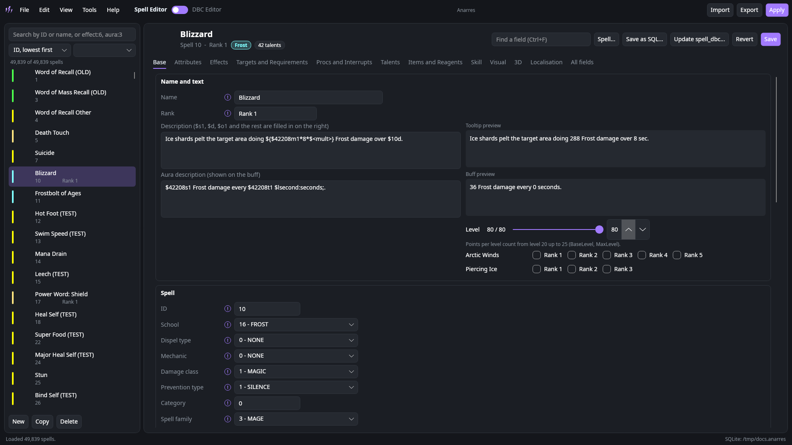

## Contents

- [Try it](#try-it)
- [Run it yourself](#run-it-yourself)
  - [What you need](#what-you-need)
  - [Get the code](#get-the-code)
  - [Run it](#run-it)
  - [Build a standalone app to share](#build-a-standalone-app-to-share)
  - [Run the tests](#run-the-tests)
- [First start](#first-start)
- [Features](#features)
- [The workflow](#the-workflow)
- [Screenshots](#screenshots)
- [For maintainers: build types and releases](#for-maintainers-build-types-and-releases)
- [Project layout and settings](#project-layout-and-settings)
- [Contributing](#contributing)
- [Credits](#credits)
- [License](#license)

The ▸ sections below open and close when you click their titles.

## Try it

Download the latest release from the [Releases page](https://github.com/TheSCREWEDSoftware/Anarres/releases/latest):
one file for Windows (`.zip`) or Linux (`.tar.gz`), with .NET included, so there's nothing else to install. Unzip
it and open `Anarres.exe` (Windows) or `Anarres` (Linux).

To hand a build to a tester before there's a release, see
[Build a standalone app to share](#build-a-standalone-app-to-share).

## Run it yourself

### What you need

| You need | Windows | Linux |
|---|---|---|
| .NET 10 SDK, to build | [Download](https://dotnet.microsoft.com/download) | Same download, or your package manager |
| Clean 3.3.5a `.dbc` files | AzerothCore's [client data](https://github.com/wowgaming/client-data/releases) (its `dbc` folder), your server's `dbc` folder, or a 3.3.5a client | Same |
| Optional: MySQL or MariaDB | Only to keep the project in a database instead of a file | Same |

Check the SDK is found by opening a terminal and running `dotnet --version` (10.0 or newer).

### Get the code

```
git clone https://github.com/TheSCREWEDSoftware/Anarres.git
cd Anarres
```

### Run it

**Windows, the easy way:** double-click `start.bat`. It builds Anarres and opens it in its own window; if Anarres is
already open it asks to close it first (Enter means yes), and it shows the crash log if Anarres closes right after
starting.

**Any system, from a terminal** in the Anarres folder:

```
dotnet run --project src/Anarres.App
```

**From an IDE:** open `Anarres.sln` in Visual Studio or Rider and run `Anarres.App`.

The first build downloads Avalonia and the other packages from NuGet, so it needs an internet connection and takes a
minute; later builds are quick.

<details>
<summary><b>Where the build goes</b></summary>

`start.bat` and `dotnet build` put the app in `src/Anarres.App/bin/Release/net10.0/` (`Anarres.exe` and its
libraries). That folder only runs on a PC with the
[.NET 10 Desktop Runtime](https://dotnet.microsoft.com/download/dotnet/10.0) installed. To give Anarres to someone
else, build the standalone app below instead.

</details>

### Build a standalone app to share

To make one file you can send to someone, which runs without .NET installed:

**Windows:** double-click `publish.bat`. It builds `publish\Anarres-win-x64.zip` (Anarres and `anarres-cli`) and
opens the folder. Send the zip; they unzip it and open `Anarres.exe`.

**Any system:**

```
./publish.sh               # linux-x64
./publish.sh win-x64       # a Windows build, from Linux
```

Or by hand:

```
dotnet publish src/Anarres.App -c Release -r win-x64 --self-contained -p:PublishSingleFile=true -o publish/win-x64
dotnet publish src/Anarres.App -c Release -r linux-x64 --self-contained -p:PublishSingleFile=true -o publish/linux-x64
```

The first standalone build downloads the .NET runtime for that system (about 70 MB), and the file is large because
.NET comes inside it. Windows may warn about an unsigned app the first time: *More info > Run anyway*.

### Run the tests

**Windows:** double-click `test.bat` to run every test and the coding standards check.

**Any system:**

```
./test.sh
```

<details>
<summary><b>More about the tests</b></summary>

- `tests/Anarres.Core.Tests`: DBC reading and writing, MPQs, the SQLite and MySQL stores, export, Apply, spell text,
  the table cache and the coding standards. Set `ANARRES_TEST_DBC` to a folder of real 3.3.5a `.dbc` files to also
  round-trip every one of them, and `ANARRES_TEST_MYSQL` (`host:port/database`, user `acore`) to test against a
  real MySQL or MariaDB.
- `tests/Anarres.App.Tests`: opens the main window and every dialog without showing them (Avalonia headless),
  edits, saves, undoes, finds fields and toggles flags.

Both run in temporary folders, so they never touch your settings or projects.

</details>

## First start

**Set up Anarres** opens on first start, like Stoneharry's editor, and asks:

1. Where your edits are kept: a SQLite project file (nothing to install) or a MySQL/MariaDB database (AzerothCore's
   `localhost:3306`, `acore`/`acore` filled in).
2. Where the clean files are: a folder of `.dbc` files, or the WoW client.
3. Your server: its data folder, and whether Apply also updates `spell_dbc` in the world database.
4. Whether to import right away.

It opens at every start until you tick *Don't show this again*; **Tools > Setup** brings it back. Everything in it is
also in **File > Project settings**.

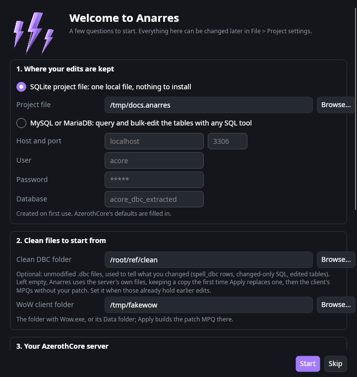

## Features

<details>
<summary><b>Spell Editor</b></summary>

Laid out after Stoneharry's [WoW Spell Editor](https://github.com/stoneharry/WoW-Spell-Editor).

- A searchable spell list: by ID, name, or `effect:6`, `aura:3`, `family:3`, `trigger:`, `icon:`... Normal rows
  show each spell's icon, ID and rank with a strip in its school's colour, and hovering one shows its tooltip;
  Compact rows fit more on screen (**View > Options > Spell Editor**).
- The chosen spell in tabs: Base, Attributes, Effects, Targets and Requirements, Procs and Interrupts, Talents,
  Items and Reagents, Skill, Visual, 3D, Localisation and All fields.
- The header shows the icon (with a border in the game's debuff colour for its dispel type), a badge for the
  school in the game's colour, and how many talents change the spell.
- Base tab: the description and buff text beside a live preview. A level slider (or a typed level, within the
  spell's own levels) and a checkbox per talent show the tooltip as a character of that level with those talents
  would see it, as Wowhead does.
- **Talents** tab: every talent, glyph, set bonus and buff that changes the spell through its family masks, with
  what each one changes. Under each effect, **Affected spells** lists the spells that effect changes.
- Effects, auras, targets, mechanics, powers and the rest picked from named lists; misc values say what they mean
  for the chosen effect or aura (a stat, a power, a school mask, a creature entry...).
- Every bit mask (attributes, procs, interrupts, target flags, shapeshifts, item subclasses...) as switches in
  columns, each with its name, its bit value (1, 2, 4...) and a note, and the whole value beside them as a number
  and in hex. The school is a dropdown of its own.
- Lists read like AzerothCore's code, such as `13 - POTION`, with *Other value...* for anything else.
- Money fields (trainer costs...) as gold, silver and copper with the raw copper value beside them; items show in
  their quality's colour with their icon.
- Cast times, durations, ranges, radii, icons and other spells shown by what they mean, not just their index.
- Spell icons from the client's MPQs, in the header and in an icon picker.
- A Visual tab for the spell's SpellVisual row and its kits; "own copy" gives the spell its own visual or kit so
  other spells sharing it don't change.
- A live tooltip preview: `$s1`, `$d`, `$o1`, `$t1`, `${...}` sums, `$<variables>`, `$?s123[a][b]`,
  `$lsingular:plural;` and references to other spells.
- New, Copy and Delete spells; Save, Revert, Undo and Redo (Ctrl+Z, Ctrl+Y).
- A Skill tab for the spell's SkillLineAbility rows, and the `trainer_spell` SQL that lets a trainer teach it.


<table>
  <tr>
    <td>
      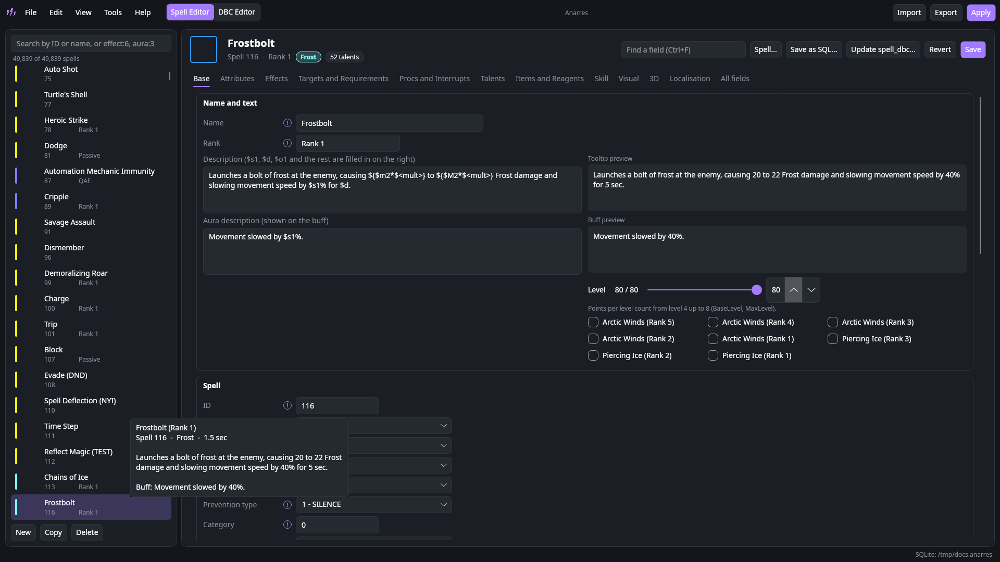<br>
      The spell list with school colours, and the card that shows when you hover a spell
    </td>
    <td>
      <br>
      The Base tab: the description beside its preview, at any level and with any talents
    </td>
  </tr>
  <tr>
    <td>
      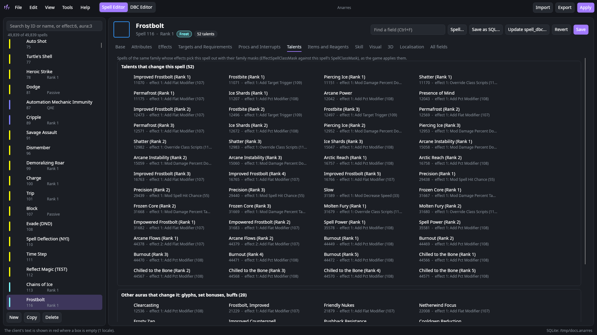<br>
      The Talents tab: every talent and aura that changes Frostbolt, and what it changes
    </td>
    <td>
      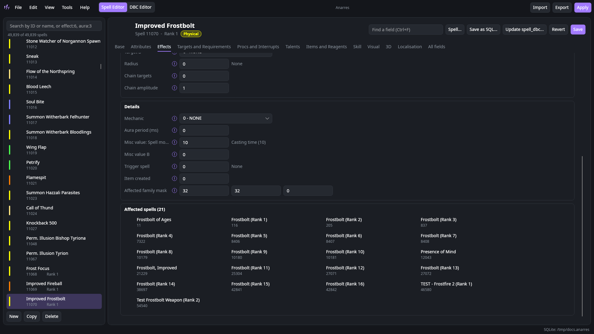<br>
      Affected spells under an effect: the 21 spells Improved Frostbolt changes
    </td>
  </tr>
  <tr>
    <td>
      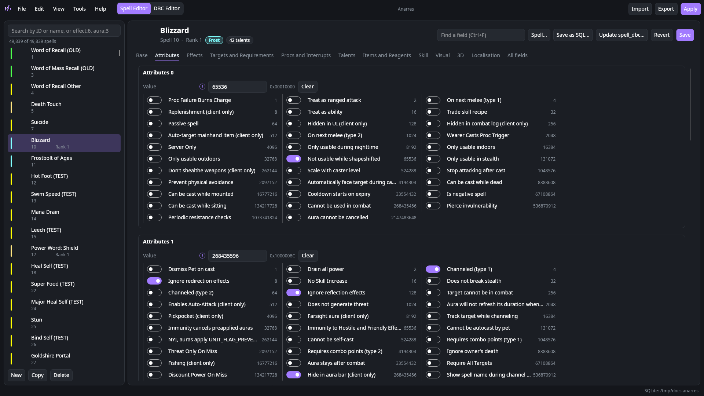<br>
      Bit masks as switches, each with its bit value, and the whole value in hex
    </td>
    <td>
      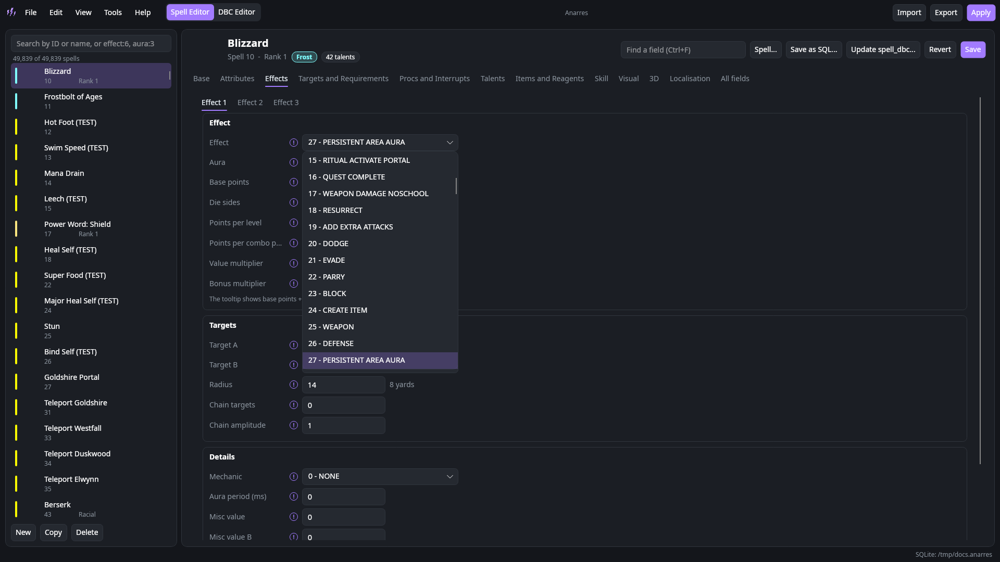<br>
      Named lists such as <code>27 - PERSISTENT AREA AURA</code>
    </td>
  </tr>
  <tr>
    <td>
      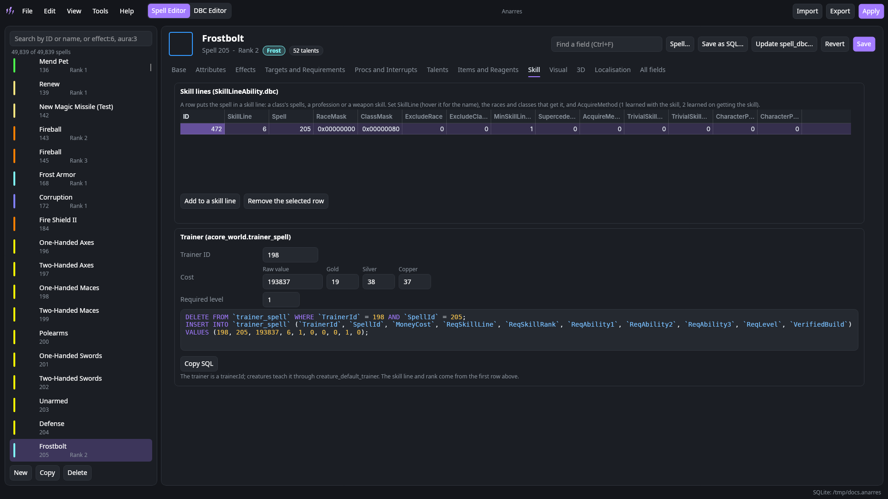<br>
      The Skill tab: the cost in gold, silver and copper, and the trainer SQL in colour
    </td>
    <td>
      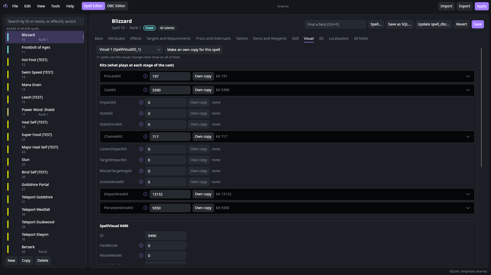<br>
      The Visual tab: the kits played at each stage, with Own copy for any of them
    </td>
  </tr>
  <tr>
    <td>
      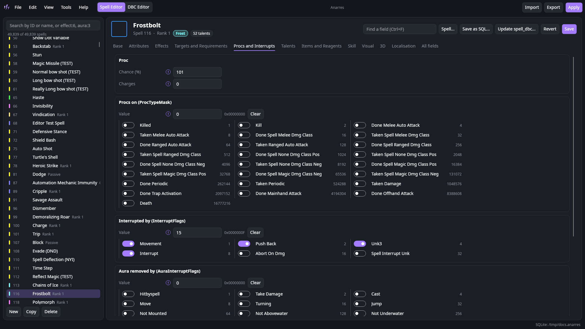<br>
      The compact spell list
    </td>
    <td>
      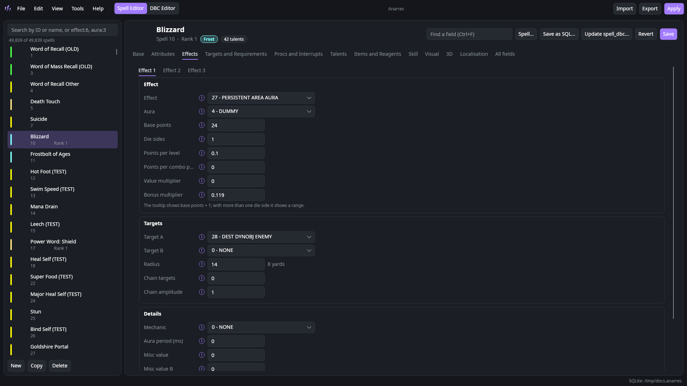<br>
      The Effects tab, with a note on every field
    </td>
  </tr>
</table>

Items show in their quality's colour with their icon when the world database can be reached; these screenshots
were taken without one.

</details>

<details>
<summary><b>3D models and effects</b></summary>

Drawn from your client's own files (its patches and custom models included); nothing comes from the internet.

- The spell editor's **3D** tab plays the spell's missile and the effects of its visual kits (precast, cast,
  channel, impact...), and shows what it summons, turns into, shapeshifts into, rides, places or makes. Creatures,
  game objects and items are looked up in the world database.
- **Tools > Model viewer...** browses every model in the client, or opens one by creature display, spell visual,
  item display or game object display ID.
- Display tables in the DBC editor (CreatureDisplayInfo, CreatureModelData, SpellVisual, SpellVisualEffectName,
  ItemDisplayInfo, GameObjectDisplayInfo, SpellShapeshiftForm) get a **3D preview** of the selected row.
- Animations from the model (and its `.anim` files), animated textures and colours, and particle emitters: the
  sparks, smoke and glows that make up most spell effects. Drag to turn, use the wheel to zoom, double-click to reset.
- Not drawn yet: ribbons (trails), buildings (WMO) and dressed character models.


No screenshot yet: the 3D view draws from a client's own models, and these screenshots were taken without a client.

</details>

<details>
<summary><b>Spell tools</b></summary>

All in the **Spell...** menu above the editor.

- **Compare with clean**: every field that differs from the clean Spell.dbc, old and new side by side, with Revert
  per field or for the whole spell.
- **Used by**: spells that trigger or teach this one, talents and auras that change it through their family masks,
  spells it triggers, and spells sharing its visual or icon.
- **New from a template**: a working direct damage, damage over time, heal, buff, proc, summon, teleport or passive
  spell, modelled on a real one, ready to change.
- **Find and replace across spells**: pick spells with the search syntax, then set, add, multiply, turn bits on or
  off, or replace text in one field. Preview first; it's one undo step.
- **Check edited spells**: indexes into tables that don't have them, missing trigger spells, auras with no aura
  type, periodic auras with no period, and fields set on an empty effect. Apply runs the same check and asks before
  going on when something looks wrong.


<table>
  <tr>
    <td>
      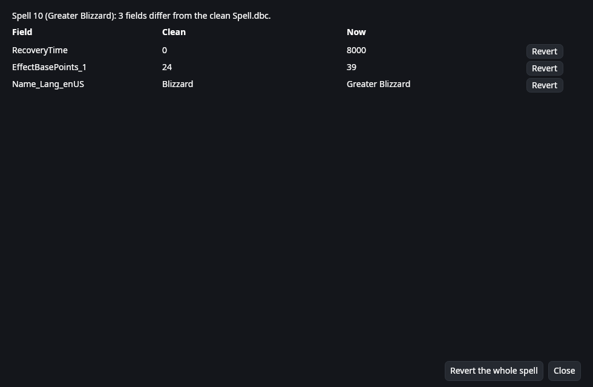<br>
      Compare with clean: each changed field, with Revert for one or all
    </td>
    <td>
      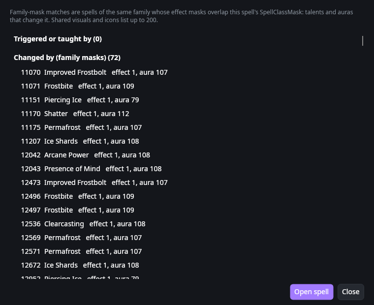<br>
      Used by: what triggers, teaches or changes Frostbolt
    </td>
  </tr>
  <tr>
    <td>
      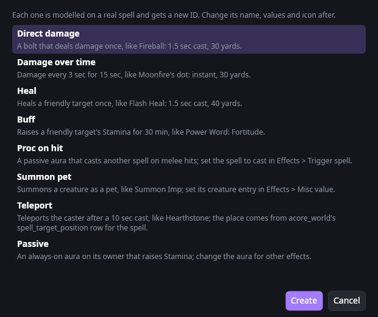<br>
      New from a template
    </td>
    <td>
      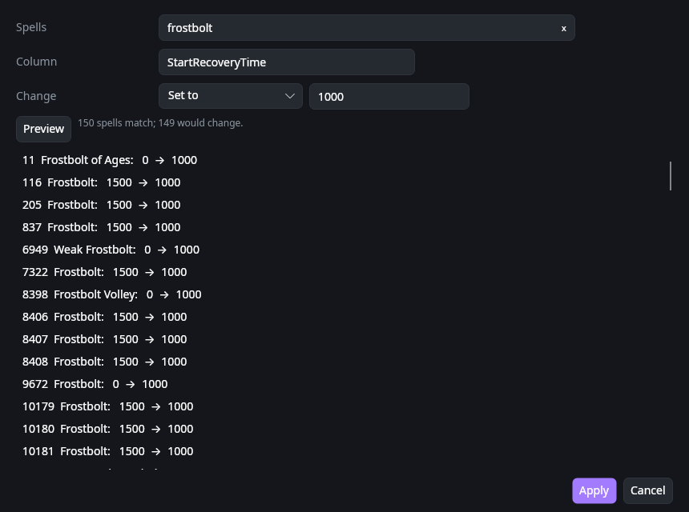<br>
      Find and replace across spells, previewed before anything changes
    </td>
  </tr>
</table>

</details>

<details>
<summary><b>Notes on every field, and Ctrl+F</b></summary>

- Every field has a readable label and, like [Keira3](https://github.com/azerothcore/Keira3), a **!** badge that
  says what the column does ("the global cooldown group; 133 is the normal global cooldown...") and its `spell_dbc`
  name. Every Spell.dbc column is described, and the lookup tables it uses; the DBC editor shows the same notes on
  its column headers.
- SQL is shown with syntax colours.
- **Ctrl+F** in a spell finds a field or flag by its label, column, notes or AzerothCore name (`school`,
  `cooldown`, `range`, `passive`, `SPELL_ATTR0_PASSIVE`), opens its tab and shows it. Ctrl+F again goes to the
  spell search.


<table>
  <tr>
    <td>
      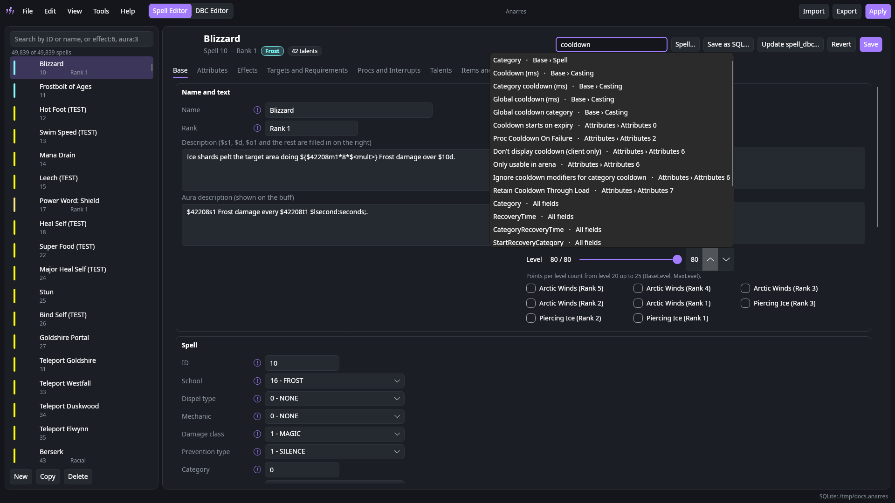<br>
      Ctrl+F finds "cooldown" across fields, flags and tabs
    </td>
    <td>
      <br>
      A <b>!</b> beside every field says what the column does
    </td>
  </tr>
</table>

</details>

<details>
<summary><b>DBC Editor</b></summary>

In the spirit of [WDBX Editor](https://github.com/WowDevTools/WDBXEditor).

- Every table in the project, or any `.dbc` opened straight from disk, in a grid that draws only what's on screen
  (Spell.dbc's 50,000 rows by 234 columns scroll smoothly). Search the table list by name.
- The **Spell Editor | DBC Editor** switch in the title bar moves between them; Spell.dbc has an **Open in Spell
  Editor** button.
- Edit cells in place, add, copy and delete rows, undo and redo, filter by ID, text or `Column=value`.
- Several tables open at once in tabs (`*` marks unsaved ones) and **Close all**. A single click opens a preview
  tab (in italics) that the next table replaces, as in VS Code; double-click or edit to keep it. Preview tabs can be
  turned off in Options.
- Shift+click, Shift+arrows and Ctrl+A select rows; Ctrl+C copies them with a header line and Ctrl+V pastes them
  into any table with matching columns. A pasted row whose ID is taken gets the next free one.
- Click a header to sort; right-click it to hide the column, hide every empty column, or show them all again.
  Double-click a column's edge to fit it to its contents; text columns start wide enough to read.
- Save to the project or back to the file, save as `.dbc` or CSV, import CSV, and write the shown rows or the rows
  changed from the clean file as SQL.
- See and rename a layout's columns, saved as a definition file that replaces the built-in one.
- 240 file layouts built in; anything else gets one guessed from its data.
- **Tools > Table links...** maps which tables point at which: pick a table to see the tables and columns that
  point at it and the ones it points at, open any of them, or save every link as a Mermaid diagram.


<table>
  <tr>
    <td>
      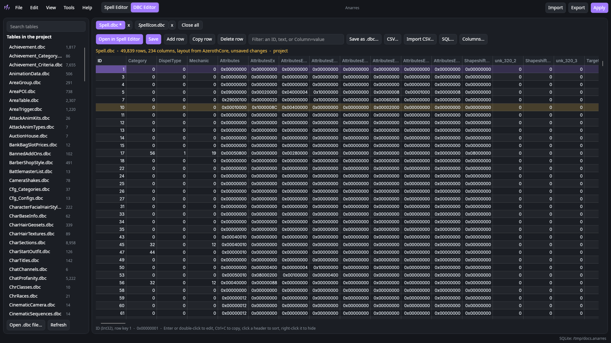<br>
      Spell.dbc with <b>Open in Spell Editor</b>, tabs and Close all
    </td>
    <td>
      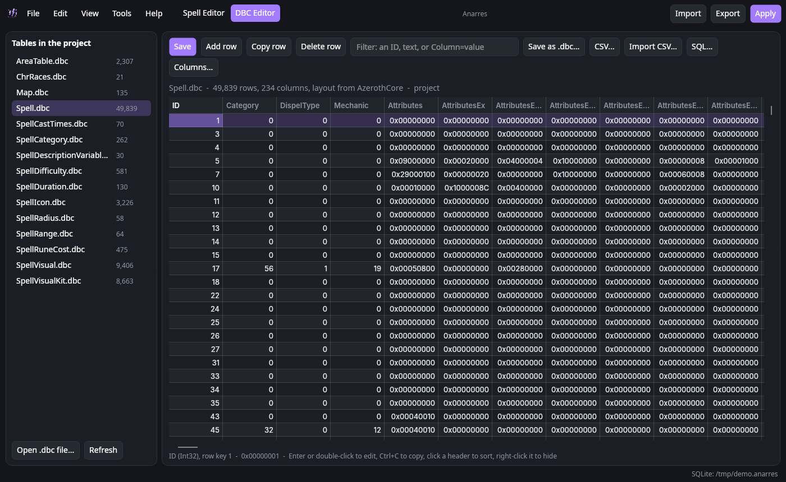<br>
      The searchable table list, and SpellIcon.dbc with its text column wide enough to read
    </td>
  </tr>
  <tr>
    <td>
      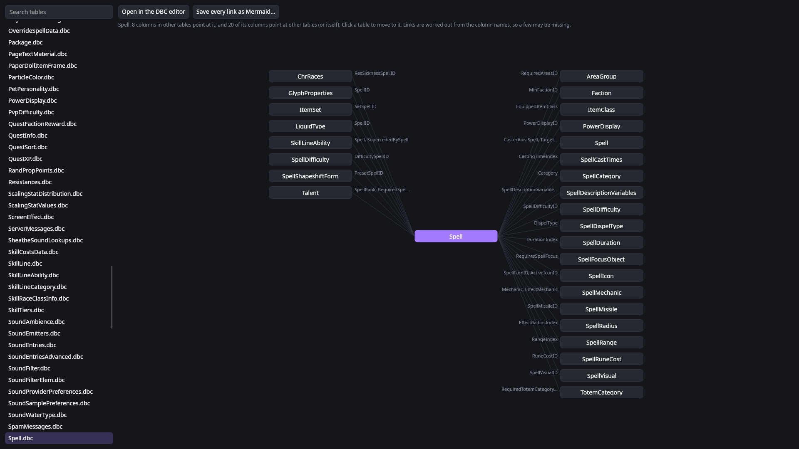<br>
      Table links: what points at Spell.dbc, and what it points at
    </td>
    <td>
      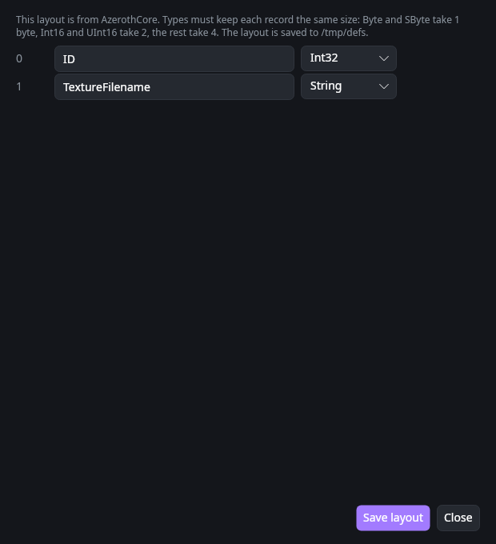<br>
      Renaming a layout's columns
    </td>
  </tr>
</table>

</details>

<details>
<summary><b>Import, export and Apply</b></summary>

- Import from a folder of `.dbc` files (or a server's Data folder) or straight out of the client's MPQs. Each
  table is saved as it's imported, and a stopped import carries on where it left off. The window says what
  language the files are in, and the locale is picked from the client's own folders. A second bar follows the
  table being imported, so a big one such as Spell.dbc visibly moves; closing the window stops the import.
- Locale **All available** reads every locale folder the client has and puts each language in its own column, so
  one Spell.dbc carries every language. It takes longer, and says so.
- The **Localisation** tab shows, in red, the client's own text for every empty language box; **Import from the
  client** copies it in for every spell.
- **Apply** (F6) in one click: save, write the edited tables, copy them to the worldserver (keeping its own copy
  once), build the client patch MPQ, empty the client's cache, and put the changed rows in `acore_world`'s
  `spell_dbc` and other `_dbc` tables.
- Only what changed: Export and Apply write the tables edited since import, so the patch holds just those, and
  `spell_dbc` gets just the changed spells.
- **Save as SQL...** and **Update spell_dbc...** write the shown spell, or every changed spell, as SQL or straight
  into the world database.
- **Tools > Compare two .dbc files...** lists every added, removed and changed row between two files, and saves it
  as a report.
- **Tools > Write a changes report...** writes every edited table against its clean file as Markdown: what you
  changed, field by field, for a changelog or a review.
- **Tools > Client patches...** shows the client's archives in the order it loads them, and warns when a later
  patch hides a file in yours.
- `anarres-cli` does all of it from scripts and build servers.


<table>
  <tr>
    <td>
      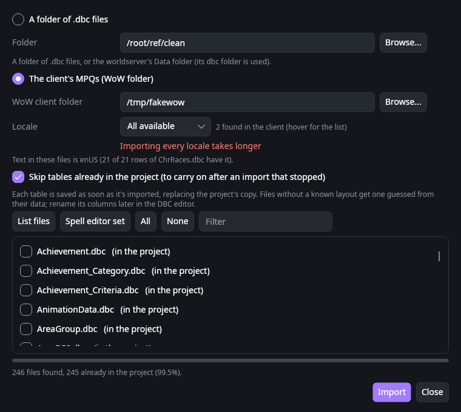<br>
      Import from the client with every locale, and the note that it takes longer
    </td>
    <td>
      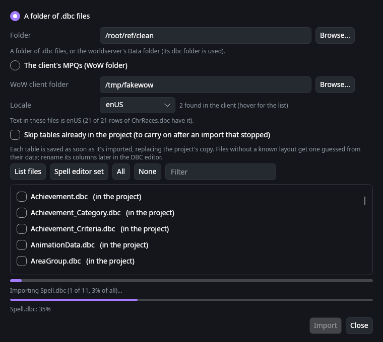<br>
      The second bar following Spell.dbc as it imports
    </td>
  </tr>
  <tr>
    <td>
      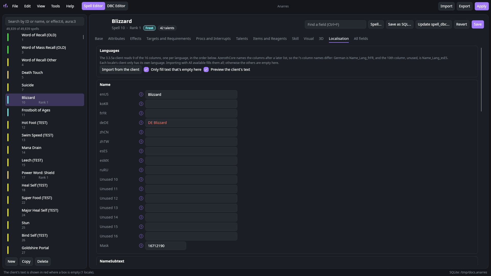<br>
      The Localisation tab: the client's German text previewed in red
    </td>
    <td>
      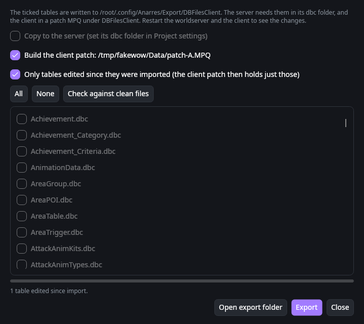<br>
      Export: only the tables edited since import, and the client patch
    </td>
  </tr>
  <tr>
    <td>
      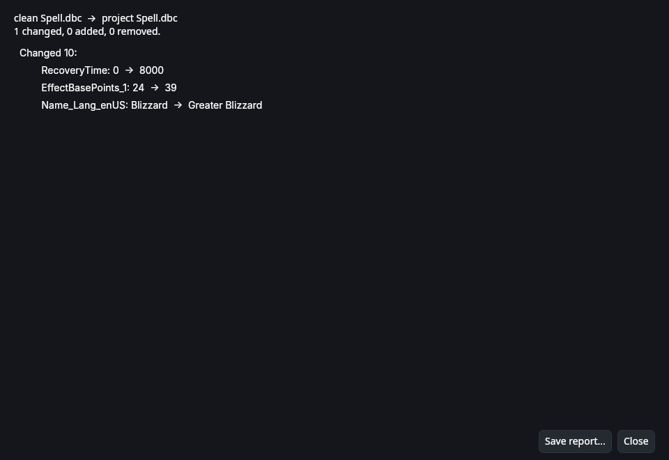<br>
      Comparing two copies of Spell.dbc: every changed field of every row
    </td>
    <td>
      <br>
      Compare with clean, from the spell editor
    </td>
  </tr>
</table>

</details>

<details>
<summary><b>Where the data lives</b></summary>

- **SQLite project file** (`.anarres`): one local file, nothing to run.
- **MySQL or MariaDB**: work on a database directly, query and bulk-edit it with any SQL tool, and share it.
  - *DBC names* (`Spell`, `SpellIcon`...) for a database just for DBC data (`acore_dbc_extracted` by default),
    like Stoneharry's editor. If your user (`acore`) isn't allowed to create it, Anarres asks once for an admin
    account such as root, creates it and gives `acore` every right on it, as AzerothCore's `create_mysql.sql` does
    for `acore_world`.
  - *AzerothCore names* (`spell_dbc`...) to work in `acore_world`'s own override tables.
- Big tables such as Spell.dbc are kept on this PC between runs and open in about 0.2 seconds instead of 1 to 2;
  the copy is used only while the database still matches it.


<table>
  <tr>
    <td>
      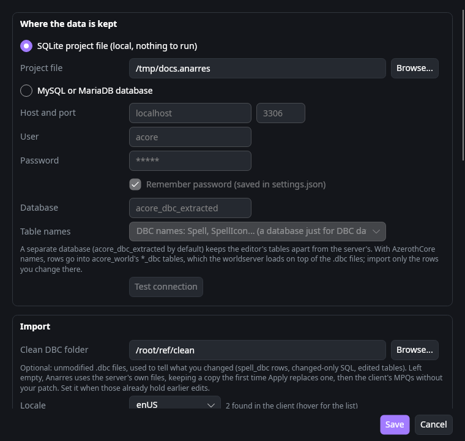<br>
      Project settings: SQLite or MySQL, the clean files, the client and the server
    </td>
    <td>
      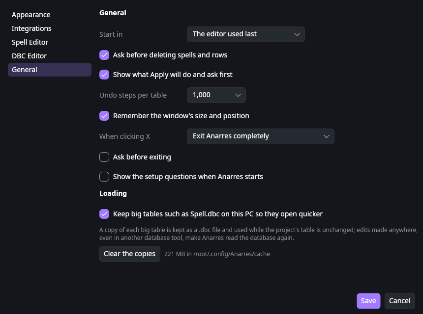<br>
      Options: the table cache, what clicking X does, and asking before exiting
    </td>
  </tr>
</table>

</details>

<details>
<summary><b>Look and options</b></summary>

- System, Dark or Light, with built-in colours, ready-made themes (Urras's GitHub, GitLab, SourceGit and Fork
  themes, and Urras, Frost, Fel, Horde, Alliance and Parchment) or your own, made in the theme editor and kept as
  files in Urras's format ([docs/themes.md](docs/themes.md)).
- Text size and font (any font on your system) for every theme or just one, with a button to give every theme the
  same size; the theme editor says which theme you're changing and restores a theme's original colours.
- The language spell names are shown in, which editor opens first, the spell list layout, preview tabs,
  confirmations, undo depth and more, in **View > Options**.
- Close to the tray instead of quitting, and confirm before exiting; both off by default.
- **View > Write a performance log** records how long loading, drawing and the 3D view take, for bug reports.
- Unexpected errors go to `crash.log` instead of closing Anarres.


<table>
  <tr>
    <td>
      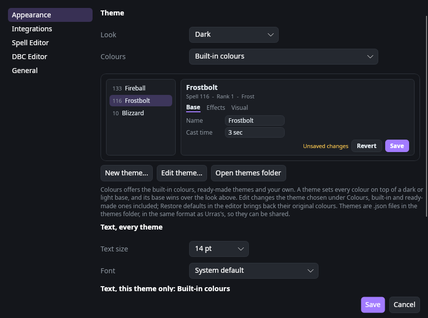<br>
      Themes with a live preview, and text size and font for every theme or just one
    </td>
    <td>
      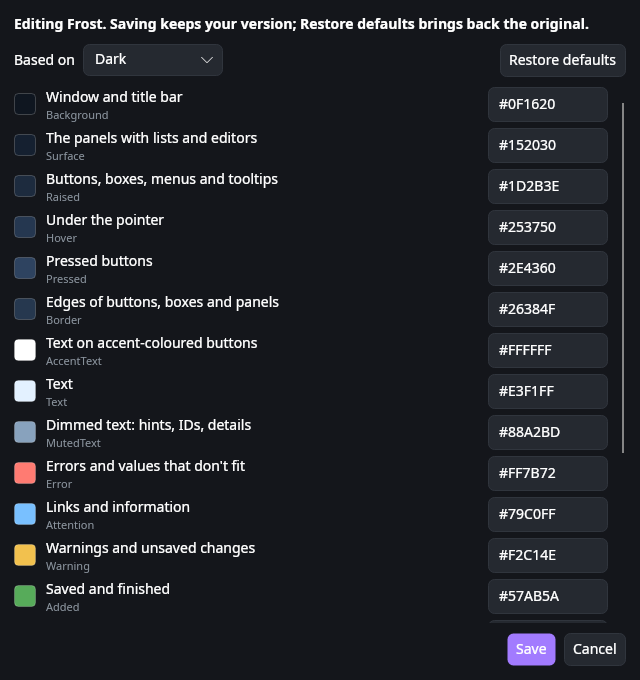<br>
      Editing the ready-made Frost theme; Restore defaults brings back its colours
    </td>
  </tr>
  <tr>
    <td>
      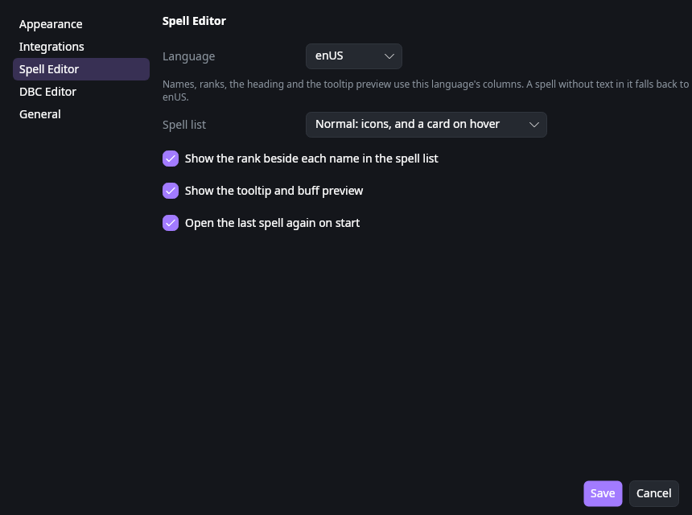<br>
      Spell Editor options: language, list layout and the tooltip preview
    </td>
    <td>
      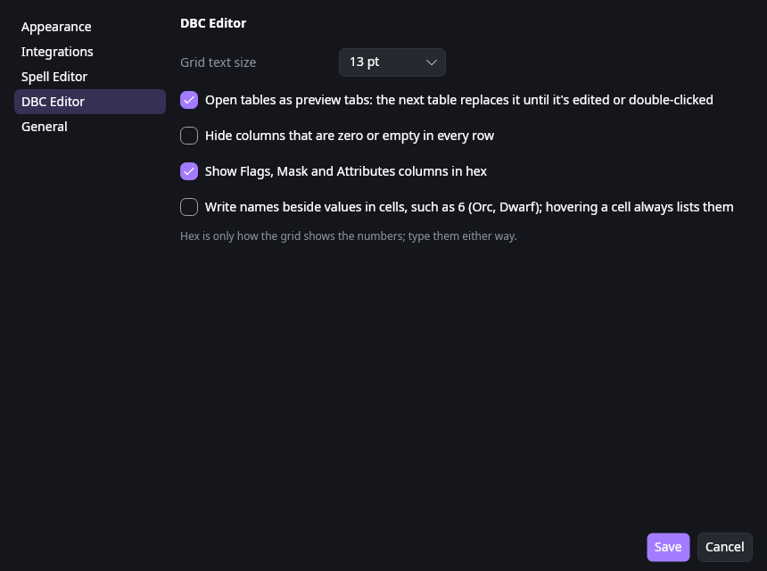<br>
      DBC Editor options: preview tabs, hex columns and names in cells
    </td>
  </tr>
</table>

</details>

## The workflow

1. **Import** clean `.dbc` files into the project.
2. **Edit** with either editor.
3. **Apply** (F6), then restart the worldserver and the client.

The data lives in a database between import and export, as in Stoneharry's
[DBC editing workflow](https://github.com/stoneharry/DBC-Editing-Workflow): `.dbc` files are packed binary tables,
while SQL can be searched, compared with the clean files, bulk-edited and shared.

<details>
<summary><b>From the command line</b></summary>

```
anarres-cli import "C:\client-data\dbc" --only Spell,SpellIcon
anarres-cli apply
anarres-cli edited
anarres-cli export --edited --server --patch
anarres-cli sql Spell --ids 90000,90001 --out custom_spells.sql
anarres-cli sql Spell --changed --out changed_spells.sql
anarres-cli patch patch-A.MPQ Spell.dbc SpellIcon.dbc
anarres-cli diff old\Spell.dbc new\Spell.dbc --out spell-changes.md
```

`anarres-cli help` lists every command and option.

</details>

[docs/workflow.md](docs/workflow.md) is the full guide: clean files, only-what-changed, spell_dbc, the cache and
the layouts.

## Screenshots

<details>
<summary><b>Show the screenshots</b></summary>

The screenshots are 1920 × 1080 and show a project imported from clean 3.3.5a `.dbc` files with no client, so
there are no spell icons; with your client's folder set, the list, header and talents show the game's icons.

<br>
The Base tab: Blizzard's description beside its live preview, with the level slider, a typed level and a checkbox
for each talent that changes it

<table>
  <tr>
    <td>
      <br>
      The Talents tab: the 52 talents and 20 other auras that change Frostbolt, and what each one changes
    </td>
    <td>
      <br>
      Attributes as switches, with each bit's value and the whole value in hex
    </td>
  </tr>
  <tr>
    <td>
      <br>
      Effects: effect, aura and targets picked from named lists, with a note on every field
    </td>
    <td>
      <br>
      The compact spell list beside Frostbolt's procs and interrupts
    </td>
  </tr>
  <tr>
    <td>
      <br>
      Localisation: the client's German text previewed in red in the empty box
    </td>
    <td>
      <br>
      Import from the client with every locale, and the note that it takes longer
    </td>
  </tr>
  <tr>
    <td>
      <br>
      The DBC editor: the searchable table list, tabs with Close all, and SpellIcon.dbc
    </td>
    <td>
      <br>
      Table links: the tables that point at Spell.dbc, and the ones it points at
    </td>
  </tr>
  <tr>
    <td>
      <br>
      Options: the theme with a live preview, and text size and font for every theme or just one
    </td>
    <td>
      <br>
      Editing the ready-made Frost theme; Restore defaults brings back its original colours
    </td>
  </tr>
</table>

</details>

## For maintainers: build types and releases

<details>
<summary><b>Build types</b></summary>

Builds default to Release, which is optimised and still has full debug symbols, so breakpoints and stack traces
work (.NET's equivalent of CMake's RelWithDebInfo). Use `-c Debug` for an unoptimised build.

</details>

<details>
<summary><b>Publishing a release</b></summary>

Push a version tag; the Release workflow tests Anarres, builds the Windows and Linux downloads and publishes them
with notes made from the changes since the last release:

```
git tag v0.1.0
git push origin v0.1.0
```

A tag with a hyphen, such as `v0.2.0-beta.1`, becomes a pre-release. The website in `site/` is published to GitHub
Pages by the Website workflow (Settings > Pages > Source: GitHub Actions).

</details>

## Project layout and settings

```
src/Anarres.Core/          DBC files, MPQs, the SQLite and MySQL stores, export, spells, settings. No UI.
src/Anarres.App/           Avalonia user interface.
src/Anarres.Cli/           anarres-cli, for scripts and build servers.
tests/Anarres.Core.Tests/  Tests for Anarres.Core, with a small built-in runner.
tests/Anarres.App.Tests/   Interface tests, run without showing any window.
tools/Anarres.Standards/   The coding standards check.
tools/*.py                 Generators for the built-in layouts.
site/                      The website.
```

Settings are stored in `%APPDATA%\Anarres` on Windows and `~/.config/Anarres` on Linux: `settings.json` (the
project), `options.json` (the look and behaviour), the default `project.anarres`, the `Export` folder, the table
`cache` and `crash.log`.

## Contributing

Read [CONTRIBUTING.md](CONTRIBUTING.md) before opening a pull request: it covers the coding standards, commit
messages and tests.

## Credits

- [AzerothCore](https://github.com/azerothcore/azerothcore-wotlk) (GPL-2.0-or-later) for the DBC layouts, column
  names and spell names.
- Stoneharry's [WoW Spell Editor](https://github.com/stoneharry/WoW-Spell-Editor) and
  [DBC Editing Workflow](https://github.com/stoneharry/DBC-Editing-Workflow), and
  [WDBX Editor](https://github.com/WowDevTools/WDBXEditor), whose layout and workflow Anarres follows;
  [Keira3](https://github.com/azerothcore/Keira3) for the idea of notes on every field and for its local model
  viewer, whose approach (models from the client's own files instead of an online viewer) the 3D view follows.
  No code was taken from them.
- [Urras](https://github.com/TheSCREWEDSoftware/Urras) for the look, the themes and the theme editor.
- [Avalonia](https://github.com/AvaloniaUI/Avalonia) (MIT),
  [MySqlConnector](https://github.com/mysql-net/MySqlConnector) (MIT) and
  [Microsoft.Data.Sqlite](https://github.com/dotnet/efcore) (MIT).
- PKWARE decompression is written from the format Mark Adler documented in `blast.c`.

## License

Copyright (C) 2026 TheSCREWEDSoftware

Anarres is free software: you can redistribute it and/or modify it under the terms of the GNU Affero General Public
License as published by the Free Software Foundation, either version 3 of the License, or (at your option) any later
version.

Anarres is distributed in the hope that it will be useful, but WITHOUT ANY WARRANTY; without even the implied
warranty of MERCHANTABILITY or FITNESS FOR A PARTICULAR PURPOSE. See the GNU Affero General Public License for more
details.

You should have received a copy of the GNU Affero General Public License along with Anarres, in [LICENSE](LICENSE).
If not, see <https://www.gnu.org/licenses/>.
